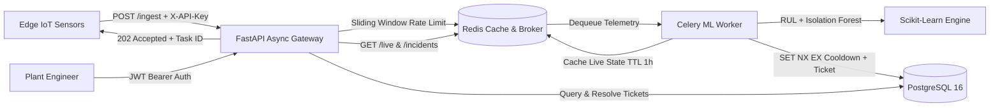

# PulseGuard — Industrial Telemetry & Predictive Maintenance Engine

**PulseGuard** is a production-grade, asynchronous backend microservice designed to ingest high-frequency industrial IoT sensor streams, run real-time Remaining Useful Life (RUL) and anomaly inference via distributed workers, and automate incident management with atomic alert deduplication.

---

## System Architecture



---

## Key Engineering Highlights

* **Non-Blocking Ingestion (`202 Accepted`):** Decouples HTTP request handling from CPU-bound ML inference using Redis brokers and Celery workers, keeping edge API p95 response latency under **20 ms**.
* **Atomic Alert Deduplication:** Uses Redis `SET NX EX` distributed locks (`300s` TTL cooldown per asset) to prevent alert storms in PostgreSQL when a turbine remains in a degraded state across consecutive cycles.
* **Sliding-Window Rate Limiting:** Protects ingestion endpoints per machine ID (`60 packets/min`) via atomic Redis `INCR` + `EXPIRE` counters, returning standard `429 Too Many Requests` responses on abuse.
* **Dual-Tier Security & RBAC:** Isolates high-throughput write-only `X-API-Key` authentication for edge hardware from `OAuth2 / JWT` Bearer authentication for plant engineers managing maintenance tickets.
* **Observability & CI/CD:** Exposes `/health` deep dependency probes, `/metrics` Prometheus telemetry, `X-Request-ID` distributed correlation headers, and automated GitHub Actions pipelines (Ruff + Pytest + Docker Buildx).

---

## Quickstart (Docker Compose)

1. **Clone & configure environment:**
   ```bash
   git clone https://github.com/LavishNarayan/pulseguard-backend.git
   cd pulseguard-backend
   cp .env.example .env
   ```

2. **Launch the 4-container stack (FastAPI, Celery Worker, PostgreSQL 16, Redis 7):**
   ```bash
   make up
   ```

3. **Run the multi-threaded IoT fleet stress test:**
   ```bash
   make simulate
   ```

4. **Explore interactive OpenAPI documentation:**
   Open `http://localhost:8000/docs`

---

## API Reference & Verification

### 1. Ingest Sensor Telemetry (Edge Device)
```bash
curl -X POST http://localhost:8000/api/v1/telemetry/ingest \
  -H "Content-Type: application/json" \
  -H "X-API-Key: pg_edge_live_98a76b54c32d10e" \
  -d '{
    "machine_code": "TURBINE-GN-04",
    "facility_zone": "SECTOR-A",
    "temperature_c": 118.4,
    "vibration_mm_s": 13.8,
    "rpm": 2540.0,
    "pressure_bar": 10.6
  }'
```

### 2. Authenticate & List Generated Maintenance Incidents (Engineer)
```bash
TOKEN=$(curl -s -X POST http://localhost:8000/api/v1/auth/token \
  -d "username=admin&password=pulseguard2026" | python3 -c "import sys, json; print(json.load(sys.stdin)['access_token'])")

curl -H "Authorization: Bearer $TOKEN" http://localhost:8000/api/v1/incidents/
```
